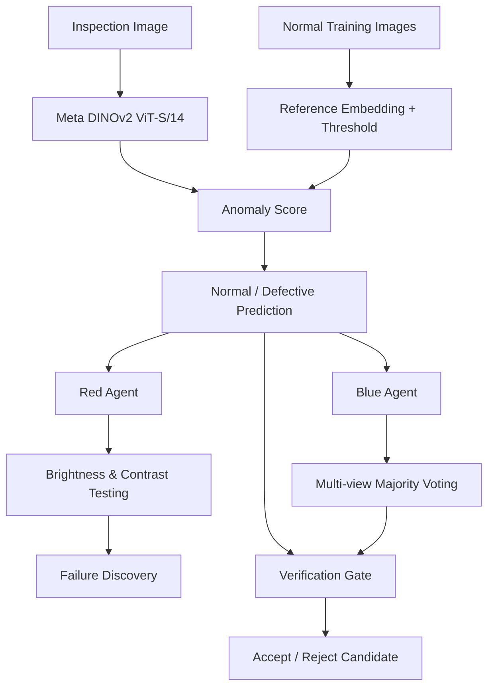
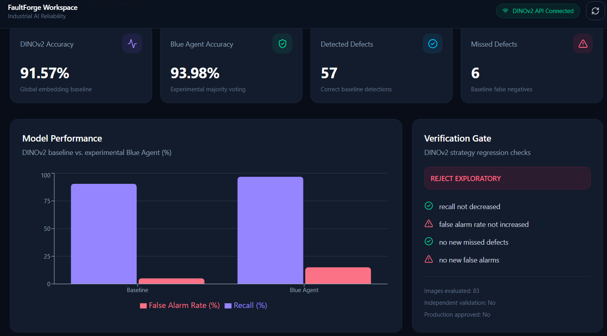
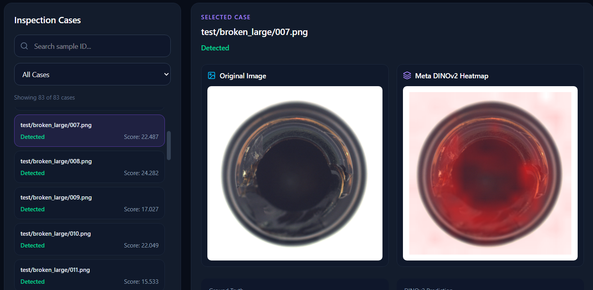
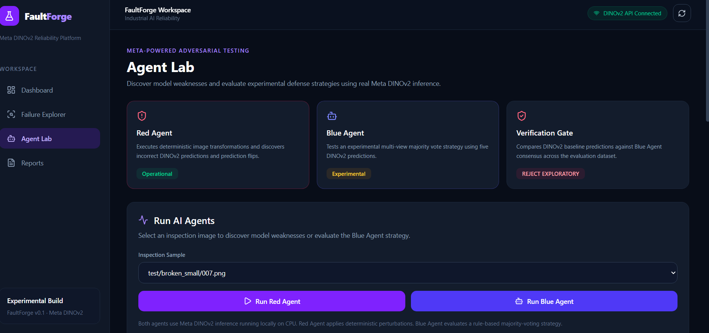

# FaultForge

**Find the failures your accuracy score misses.**

FaultForge is an AI reliability testing platform built around Meta's DINOv2 vision model. It helps uncover missed defects, test how predictions change under different image conditions, and check whether a proposed fix actually makes a model more reliable.

Built for the **Meta Global AI Developer Hackathon 2026**.

**Tech stack:** Meta DINOv2 · PyTorch · FastAPI · React · TypeScript · Tailwind CSS

---
## Meta Open Models

FaultForge uses **Meta DINOv2 (ViT-S/14)**, an open-weight computer vision model developed by Meta AI Research.

We use DINOv2 to extract image embeddings and build an anomaly detection baseline using normal reference images.

On top of DINOv2, we built:

- **Failure Explorer:** Visualizes model predictions, missed defects, and anomaly heatmaps.
- **Red Agent:** Tests prediction stability under controlled brightness and contrast changes.
- **Blue Agent:** Evaluates an experimental multi-view majority-voting strategy.
- **Verification Gate:** Compares the baseline and proposed strategy, including accuracy, missed defects, and false alarms.

**Model license:** Apache License 2.0.

**Original model:** https://github.com/facebookresearch/dinov2

FaultForge uses DINOv2 locally through PyTorch without relying on Meta's Model API.

## Why FaultForge?

A model can report good accuracy and still make mistakes that matter.

Imagine a visual inspection system in a factory. It correctly detects most defective products, but misses a few damaged ones. You introduce a new strategy and accuracy improves. Great, right?

Not necessarily.

What if that same change also causes more perfectly good products to be rejected?

That's the problem we're exploring with FaultForge.

Instead of looking at accuracy alone, we wanted a way to investigate individual failures, stress-test predictions, and evaluate improvements against clear reliability checks.

## How it works

FaultForge uses **Meta DINOv2 ViT-S/14** to extract visual features from inspection images. These features are compared against a reference built from normal images to produce anomaly scores and predictions.

From there, two testing components examine the model's behavior.



### Red Agent — Finding weaknesses

Red Agent tests the same inspection image under different conditions: original, darker, brighter, lower contrast, and higher contrast.

It records prediction changes and incorrect classifications so we can understand which conditions make the model unreliable.

The current Red Agent uses deterministic image transformations with real DINOv2 inference, rather than an autonomous language-model agent.

### Blue Agent — Testing a possible fix

Blue Agent explores a simple defense: instead of trusting a single prediction, it takes a majority vote across five image conditions.

This sometimes helps recover defects that the baseline misses.

But an improvement on one image doesn't mean the strategy is better overall. That's where the Verification Gate comes in.

### Verification Gate — Checking the trade-offs

The Verification Gate compares the baseline and candidate strategy across the evaluation dataset.

It checks whether defect recall improves without introducing new missed defects or false alarms.

If a proposed change violates the configured checks, FaultForge rejects it, even when its overall accuracy is higher.

## What we found

We tested our DINOv2 baseline and Blue Agent candidate on **83 images from the MVTec AD Bottle dataset**.

Here are the results:

| Metric | DINOv2 Baseline | Blue Agent |
|---|---:|---:|
| Accuracy | 91.57% | 93.98% |
| Precision | 98.28% | 95.31% |
| Defect recall | 90.48% | 96.83% |
| False alarm rate | 5.00% | 15.00% |
| Missed defects | 6 | 2 |
| False alarms | 1 | 3 |

The Blue Agent reduced missed defects from six to two and improved accuracy.

**But the Verification Gate rejected it.**

The candidate introduced two new false alarms, increasing the false alarm rate from 5% to 15%.

That's an important result for this project. A model update can solve one problem while creating another. We wanted FaultForge to make that trade-off visible rather than simply report the higher accuracy.

**Verification result:** `REJECT_EXPLORATORY`

These are exploratory results from a dataset already examined during development. They are not independent validation or evidence that the system is ready for production.

## Inside the app

FaultForge has four main views.

### Dashboard

A quick overview of model performance, missed defects, false alarms, and the latest verification decision.


### Failure Explorer

A place to inspect individual predictions.

For each image, we show its ground-truth label, predicted label, anomaly score, and a DINOv2 patch-distance heatmap.

The heatmap helps visualize relative spatial differences, but it should not be treated as a validated defect-segmentation mask.


### Agent Lab

Run Red Agent and Blue Agent on a selected image and compare the results.

The lab also includes the batch reliability scan and Verification Gate report.



### Reports

Review the experimental comparison and export the available DINOv2 results as JSON.

*Screenshots and a short walkthrough video will be added once the final demo is prepared.*

## Running locally

FaultForge is currently a local research prototype. The backend runs with FastAPI, the frontend with Vite, and DINOv2 inference runs through PyTorch on CPU.

### Requirements

- Python
- Node.js and npm
- Git
- Enough memory for PyTorch and DINOv2
- Internet access for the first model download
- A locally prepared inspection dataset and generated experiment results

### 1. Clone the repository

```powershell
git clone https://github.com/BlendaPonxhaj/FaultForge.git
cd FaultForge
```

### 2. Set up the backend

Create and activate a virtual environment:

```powershell
python -m venv .venv
.\.venv\Scripts\Activate.ps1
```

Install the main dependencies:

```powershell
python -m pip install torch torchvision numpy pillow fastapi uvicorn pydantic httpx
```

The repository does not yet include a fully pinned Python dependency file. Some historical experiment scripts may require additional packages.

### 3. Prepare the dataset

The current experiments use the **MVTec AD Bottle** dataset.

The expected local structure is:

```text
experiments/
└── data/
    └── mvtec/
        └── bottle/
            ├── train/
            │   └── good/
            └── test/
                ├── good/
                ├── broken_small/
                ├── broken_large/
                └── contamination/
```

Dataset files are excluded from Git and must be obtained separately, subject to their license.

### 4. Generate the experiment results

The main DINOv2 scripts are:

```text
experiments/calibrate_dinov2.py
experiments/evaluate_dinov2.py
experiments/generate_dinov2_heatmaps.py
backend/verification/dinov2_gate.py
```

Calibration creates the normal reference and threshold. Evaluation computes inspection results, while the remaining scripts generate visualizations and candidate-strategy verification evidence.

The application expects local artifacts such as:

```text
experiments/results/
├── dinov2_calibration.json
├── dinov2_evaluation.json
├── dinov2_failures.json
└── dinov2_gate.json
```

These generated files are not included in GitHub.

**Important:** The current repository is not yet a one-command, fully reproducible demo. A fresh clone needs the dataset and generated results before all dashboard and inspection features can work.

### 5. Start FastAPI

From the project root:

```powershell
python -m uvicorn backend.main:app --reload
```

API: http://127.0.0.1:8000

API documentation: http://127.0.0.1:8000/docs

### 6. Start the frontend

Open another terminal:

```powershell
cd frontend
npm install
npm run dev
```

Frontend: http://localhost:5173

### 7. Build the frontend

```powershell
npm run build
```

This runs the TypeScript checks and creates the Vite production build.

## A quick demo flow

The easiest way to understand FaultForge is to follow one failure through the system.

1. Open the Dashboard to see baseline performance.
2. Go to Failure Explorer and select `test/broken_small/007.png`.
3. Notice that the image is defective, but the DINOv2 baseline predicts normal.
4. Run Red Agent to see how the prediction changes under brightness and contrast adjustments.
5. Run Blue Agent to test the multi-view consensus strategy.
6. Open the Verification Gate and see why the strategy is rejected despite improving overall accuracy.

This is the core FaultForge workflow: **find a failure, investigate it, test a possible fix, and check the consequences.**

## Built with Meta AI

Our primary AI model is [Meta DINOv2](https://github.com/facebookresearch/dinov2), using the `dinov2_vits14` checkpoint.

DINOv2 provides 384-dimensional image embeddings, which we use for reference-based anomaly detection.

The model performs the underlying image analysis in the inspection, Red Agent, and Blue Agent workflows. The testing and verification logic around it is implemented in Python.

This setup runs locally on CPU and does not require a hosted AI API.

## Limitations and dataset use

FaultForge is an experimental prototype, not a production-certified industrial inspection system.

There are several limitations worth being clear about:

- Results are based on a small evaluation set and are exploratory.
- The same dataset was examined during development, so the results are not independent validation.
- The Blue Agent strategy has not been approved for production use.
- The current heatmaps are visual explanations of patch distances, not validated segmentation masks.
- Local dataset files and generated experiment results are required to reproduce the demo.

**Dataset licensing:** Our experiments use the MVTec AD Bottle dataset, provided by MVTec Software GmbH and distributed under the CC BY-NC-SA 4.0 license.

Dataset source: [MVTec Anomaly Detection Dataset](https://www.mvtec.com/company/research/datasets/mvtec-ad)

## What's next?

We'd like to extend FaultForge with support for user-provided datasets, broader reliability tests, better defense strategies, and independent evaluation across different inspection scenarios.

For now, the goal is straightforward: make model failures easier to find, understand, and evaluate.

---

**FaultForge** · Meta Global AI Developer Hackathon 2026
